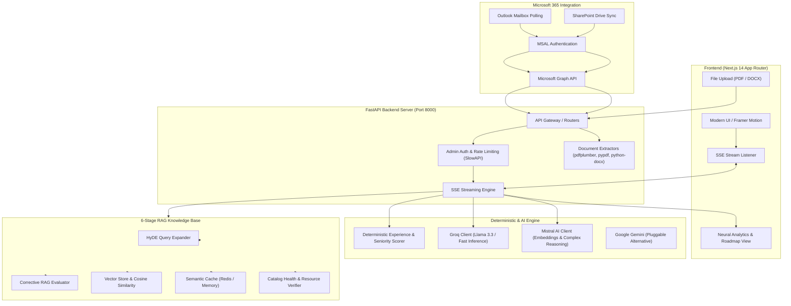

# Friction Matcher

[](https://nextjs.org/)
[](https://fastapi.tiangolo.com/)
[](https://www.python.org/)
[](https://groq.com/)
[](LICENSE)

**Friction Matcher** is an enterprise-grade, AI-augmented talent intelligence and career transition platform. It evaluates the "friction" between candidate profiles (from direct file uploads, Microsoft Outlook emails, or SharePoint document libraries) and Job Descriptions (JDs). 

Going far beyond conventional keyword-matching ATS tools, Friction Matcher combines deterministic experience and seniority algorithms, a 6-stage Corrective RAG knowledge engine, and multi-model LLMs (Groq & Mistral) to deliver precise match scoring, gap diagnostics, and hyper-personalized career roadmaps with verified learning resources.

---

## 🌟 Key Capabilities

### 1. Deterministic Multi-Factor Scoring
- **Years of Experience & Recency Decay:** Multi-pass regex and date span parsing (`python-dateutil`) calculates exact professional tenure with dynamic calendar math and recency decay weighting (recent relevant roles are weighted higher).
- **Seniority & Skill Matrix:** Mathematical alignment of candidate seniority levels against role requirements with customizable weighting (`SKILLS_WEIGHT=0.6`, `SENIORITY_WEIGHT=0.4`) and automatic re-normalization when seniority is unspecified.
- **Domain Mismatch & Career Transition Detection:** Detects cross-industry shifts and produces specialized transition roadmaps and interview questions.

### 2. Enterprise Microsoft 365 Ingestion
- **Microsoft Outlook Polling (`/api/v1/outlook/*`):** Automated or on-demand mailbox scanning via MSAL & Microsoft Graph API. Downloads and processes candidate resumes from PDF/DOCX email attachments and parses email body submissions with footer and disclaimer stripping.
- **SharePoint Document Library Sync (`/api/v1/sharepoint/*`):** Connects to enterprise SharePoint sites to batch index, extract, and evaluate candidate resumes directly from shared document drives.

### 3. 6-Stage RAG Knowledge & Roadmap Engine
- **HyDE (Hypothetical Document Embeddings):** Generates targeted transition hypotheses to maximize retrieval relevance for non-traditional candidates.
- **CRAG (Corrective RAG):** Evaluates retrieved document relevance with confidence scoring, dynamically falling back to web search (Tavily) if internal knowledge confidence is low.
- **Knowledge Graph & Transition Matrix:** Cross-maps skills across tech, data, product, and leadership domains.
- **Curated Resource Verification:** Integrates with catalog health checkers and verified resource databases to ensure candidates receive active, high-quality YouTube tutorials and official documentation links.
- **Semantic Caching:** High-speed in-memory vector cache with cosine similarity deduplication to deliver sub-50ms repeat responses.

### 4. Real-Time Streaming & Modern UX
- **Server-Sent Events (SSE) Stream (`/api/v1/analyze/stream`):** Live token-by-token evaluation streaming directly to the Next.js frontend with neural milestone loading indicators.
- **Unified Document Parser:** Robust ingestion supporting PDF documents (via `pdfplumber` with modern `pypdf` fallback), Microsoft Word (`python-docx`), and live JD web fetching.

---

## 🏗️ System Architecture



---

## 📁 Repository Structure

```text
friction/
├── backend/                     # FastAPI Backend Application
│   ├── app/
│   │   ├── ai/                  # AI clients (Groq, Mistral, prompts, explainer)
│   │   ├── api/                 # API route controllers (analyze, outlook, sharepoint, advanced)
│   │   ├── core/                # Configuration (pydantic-settings), rate limits, security
│   │   ├── enterprise/          # Microsoft Graph, Outlook, SharePoint services
│   │   ├── knowledge/           # 6-stage RAG engine, vector store, semantic cache
│   │   ├── models/              # Pydantic schemas and scoring models
│   │   ├── parsers/             # Document parsers (PDF, DOCX, JD scrapers)
│   │   └── utils/               # Logging (Loguru), date math, link verification
│   ├── tests/                   # 366+ Hermetic unit and integration tests
│   └── pytest.ini               # Pytest configuration
├── frontend/                    # Next.js 14 Web Application
│   ├── src/
│   │   ├── app/                 # Next.js App Router pages and layout
│   │   ├── components/          # React components (ResumeInput, JDInput, NeuralLoader)
│   │   ├── hooks/               # Custom React hooks (useStreamingAnalysis, useAdminState)
│   │   └── services/            # API client and SSE streaming handlers
│   ├── package.json             # Frontend dependencies
│   └── tailwind.config.js       # Tailwind CSS styling configuration
├── requirements.txt             # Python backend dependencies
└── README.md                    # Project documentation
```

---

## 🛠️ Getting Started

### Prerequisites
- **Python:** 3.11 or 3.12+
- **Node.js:** 18.x or 20.x+ (with `npm` or `pnpm`)
- **API Keys:**
  - [Groq API Key](https://console.groq.com/) (Required for primary rapid inference)
  - [Mistral API Key](https://console.mistral.ai/) (Required for embeddings and deep reasoning)
  - *(Optional)* Microsoft Entra ID App Credentials (for Outlook/SharePoint integration)
  - *(Optional)* Redis Server (for multi-instance semantic caching)

---

### Backend Setup

1. **Activate or create a Python virtual environment** from the project root:
   ```bash
   python -m venv venv
   # On Windows:
   .\venv\Scripts\activate
   # On macOS/Linux:
   source venv/bin/activate
   ```

2. **Install dependencies**:
   ```bash
   pip install -r requirements.txt
   ```

3. **Configure Environment Variables**:
   Create a `.env` file in the `backend/` directory:
   ```bash
   cd backend
   cp .env.example .env   # Or create backend/.env manually
   ```
   Add your API keys:
   ```env
   GROQ_API_KEY="your-groq-api-key"
   MISTRAL_API_KEY="your-mistral-api-key"
   ADMIN_API_KEY="your-secure-admin-key"
   CORS_ORIGINS="http://localhost:3000"
   ```

4. **Start the FastAPI backend server**:
   ```bash
   uvicorn app.main:app --reload --port 8000
   ```
   - API Server: `http://localhost:8000`
   - Interactive Swagger Docs: `http://localhost:8000/docs`
   - Health Check: `http://localhost:8000/health`

---

### Frontend Setup

1. **Navigate to the frontend directory**:
   ```bash
   cd frontend
   ```

2. **Install frontend packages**:
   ```bash
   npm install
   ```

3. **Start the Next.js development server**:
   ```bash
   npm run dev
   ```
   - Web Application: `http://localhost:3000`

---

## ⚙️ Environment Configuration Reference

| Variable | Required | Description | Default / Example |
| :--- | :---: | :--- | :--- |
| `GROQ_API_KEY` | **Yes** | Primary LLM inference engine key | `gsk_...` |
| `MISTRAL_API_KEY` | **Yes** | Embeddings and secondary reasoning key | `...` |
| `ADMIN_API_KEY` | **Yes** | Secret key for administrative diagnostic endpoints | `secret-admin-key` |
| `TAVILY_API_KEY` | Optional | Web search fallback for Corrective RAG (CRAG) | `tvly-...` |
| `AZURE_TENANT_ID` | Optional | Microsoft Entra ID Tenant ID for Outlook / SharePoint | UUID |
| `AZURE_CLIENT_ID` | Optional | Microsoft Entra ID Registered App Client ID | UUID |
| `AZURE_CLIENT_SECRET` | Optional | Microsoft Entra ID Client Secret Value | String |
| `SHAREPOINT_SITE_ID` | Optional | Target SharePoint Site Identifier | String |
| `REDIS_URL` | Optional | Redis connection URL for distributed caching | `redis://localhost:6379/0` |
| `CORS_ORIGINS` | Optional | Allowed origins for cross-origin requests | `http://localhost:3000` |
| `SKILLS_WEIGHT` | Optional | Weight given to technical/soft skills match | `0.6` |
| `SENIORITY_WEIGHT` | Optional | Weight given to seniority alignment | `0.4` |

---

## 🔌 Core API Endpoints

| Method | Endpoint | Description |
| :--- | :--- | :--- |
| `POST` | `/api/v1/analyze` | Synchronous resume-to-JD friction analysis and scoring. |
| `POST` | `/api/v1/analyze/stream` | Server-Sent Events (SSE) real-time streaming candidate analysis. |
| `POST` | `/api/v1/parsers/upload-resume` | Uploads and extracts structured text from PDF or DOCX files. |
| `POST` | `/api/v1/parsers/fetch-jd-url` | Scrapes and cleans job description content from a web URL. |
| `POST` | `/api/v1/outlook/fetch-resumes` | Polls configured Outlook inbox for new resumes and auto-evaluates. |
| `POST` | `/api/v1/sharepoint/sync` | Syncs and indexes candidate documents from SharePoint folders. |
| `GET` | `/api/v1/advanced/catalog-health` | Validates URLs and health status of curated learning resources. |
| `GET` | `/health` | Server liveness and dependency status check. |

---

## 🧪 Testing & Quality Assurance

Friction Matcher includes a comprehensive hermetic test suite with **366+ unit and integration tests** verifying all parsers, prompt templates, seniority matrices, RAG stages, and Microsoft Graph integrations without calling external paid APIs:

```bash
# Navigate to backend
cd backend

# Run the complete hermetic test suite:
pytest tests -m "not live" -q

# Run with verbose output and coverage report:
pytest tests -v --cov=app

# Run only RAG-specific validation tests:
pytest tests/test_rag* -q

# Run Microsoft 365 Outlook & SharePoint integration tests:
pytest tests/test_outlook_service.py tests/test_sharepoint_service.py -q
```

To verify the Next.js production frontend build:
```bash
cd frontend
npm run build
```

---

## 🔒 Security & Enterprise Reliability

- **Hermetic by Default:** Ingestion pipelines sanitize raw inputs, strip script injections, and enforce Pydantic schema validation across all inputs and outputs.
- **Constant-Time Verification:** Administrative routes use `hmac.compare_digest` to eliminate timing attacks on API keys.
- **Fallback Resilience:** PDF parsing gracefully cascades from `pdfplumber` to `pypdf`, and external AI generation employs exponential backoff retries via `tenacity`.
- **Zero Local Password Storage:** Enterprise identity is mediated strictly through Microsoft Entra / OAuth 2.0 client credential flows.

---

## 📄 License

This project is licensed under the MIT License — see the [LICENSE](LICENSE) file for details.
